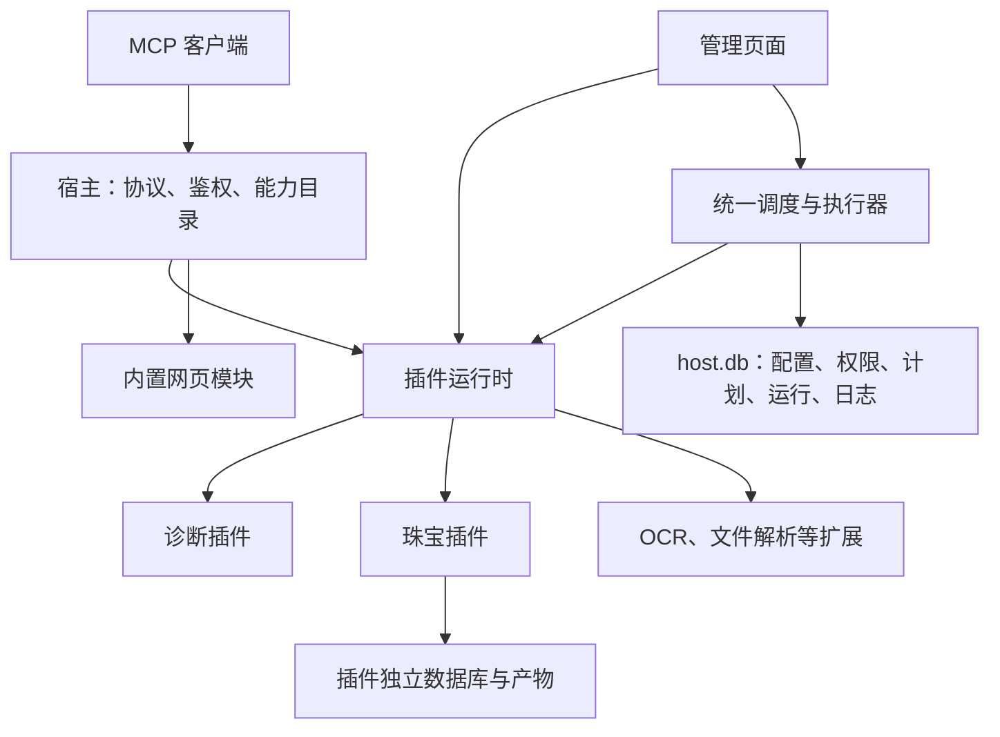

# KaungMcp 插件开发与运行

KaungMcp 是单实例 .NET 10 宿主。宿主处理 MCP、鉴权、能力权限、配置、调用日志与持久化调度；插件提供工具、提示词、资源、业务服务、独立数据库、任务处理器和默认计划。插件只引用契约和必要基础库，不引用宿主或其他业务插件。



## 项目边界

| 项目 | 职责 |
|---|---|
| `KaungMcp.Plugin.Abstractions` | 生命周期、能力注册、任务、配置、健康和结果引用契约；共享 MCP SDK 类型 |
| `KaungMcp.Foundation` | 安全网络访问、robots、通用配置读取与持久化；无业务采集调度 |
| `KaungMcp` | 目录发现、独立 AssemblyLoadContext、能力/权限目录、任务队列、API、管理页面 |
| `KaungMcp.Plugins.Diagnostics` | ping、echo、连接诊断提示词和状态资源；无默认任务 |
| `KaungMcp.Web` | 宿主直接引用的搜索和网页读取模块；无插件清单及默认任务 |
| `KaungMcp.Plugins.Jewelry` | 数据工具、采集服务、独立 SQLite、采集处理器及三个默认计划 |

宿主对首批插件的项目引用只用于构建分发包，不将插件类型引入宿主运行依赖。第三方插件通过目录发现，无需增加宿主引用。共享契约、基础库、MCP SDK、框架及 EF/SQLite 边界程序集使用宿主版本，其他依赖由各插件的 `.deps.json` 解析。

## 安装目录和生命周期

```text
plugins/{pluginId}/
  plugin.json
  插件.dll、依赖.dll、插件.deps.json、原生依赖

data/host.db
data/plugins/{pluginId}/plugin.db
data/plugins/{pluginId}/artifacts/
```

`Plugins:Directory` 默认相对宿主程序集目录解析；`Plugins:DataDirectory` 默认 `data/plugins`，相对工作目录解析。生产部署推荐绝对路径。启动脚本首次复制内置插件到 `.kaung/plugins`，之后使用该独立安装目录，重新构建不会恢复已卸载插件。

启动依次执行清单校验、程序集加载、注册项与能力冲突检查、数据库和依赖初始化，最后开放 MCP 和调度。失败插件在管理页显示错误，其他插件继续启动。清单 ID 必须与目录名一致，契约版本首版为 `1`。

- 安装、升级、卸载：停止服务，复制、替换或移除整个插件目录，再启动。
- 停用：即刻阻止新调用与新任务，取消尚未运行的排队任务；正在执行的任务允许完成。
- 当次启动已初始化的插件可以即时重新启用；启动时未加载的插件重新启用后显示“待重启”。
- 卸载保留配置、计划、运行历史、数据库和产物；计划阻塞，管理页显示“插件缺失”。
- 相同 ID 重装恢复关联；任务定义版本、参数或风险声明不兼容时保持阻塞，需要管理员编辑。
- 关闭宿主停止接收执行请求，最多等待运行任务 120 秒，再请求取消。

首版插件是可信进程内代码。依赖加载隔离不提供安全沙箱、进程崩溃隔离或热卸载；同一份数据只运行一个宿主实例。

## 可编译的开发模板

`templates/KaungMcp.Plugin.Sample` 包含工具、带参数资源、后台任务、默认停用计划、动态配置以及产物引用，可直接编译安装。宿主正在运行时先停止，再执行：

```sh
dotnet publish templates/KaungMcp.Plugin.Sample -c Release -o .kaung/plugins/sample
./start.sh --no-open
```

如果尚未运行过启动脚本，先运行一次以初始化内置插件目录。模板不会在普通宿主构建时自动安装。

创建实际插件时复制模板目录，修改项目引用相对路径、程序集名、命名空间、工具名及清单 ID/入口；目录使用相同插件 ID。保持 `EnableDynamicLoading=true` 并复制完整发布输出，勿只复制主 DLL。发布模板只引用 Foundation，Foundation 间接引用 Abstractions；无基础服务需求时可直接引用 Abstractions。

```json
{
  "id": "sample",
  "name": "示例插件",
  "version": "1.0.0",
  "contractVersion": 1,
  "entryAssembly": "KaungMcp.Plugin.Sample.dll",
  "entryType": "KaungMcp.Sample.SamplePlugin"
}
```

能力、处理器、参数定义及默认计划在 `Register` 中声明，清单不重复列出。处理器通过作用域 DI 解析，注册为 transient 或 scoped；工具和处理器共用插件内部业务服务。`InitializeAsync` 创建/初始化插件数据库；宿主已经创建插件数据及 `artifacts` 目录。每次执行都有独立 DI 作用域。

`IPluginTaskHandler` 校验业务约束、返回资源并发键、执行业务并返回 `PluginTaskResult`。调整参数语义或处理器接口时递增任务定义 `Version`，不覆盖已保存计划。大结果写入插件自身产物目录，返回 `ArtifactReference`；引用 ID 的解析/下载由插件资源或工具提供。

`PluginToolPolicy.Schedulable` 默认 `false`；可调度工具可以通过 `ScheduleValidatorType` 指定 `IPluginTaskValidator`，用于业务校验与资源并发键。任务处理器无需同时暴露为 MCP 工具。

参数 Schema 支持对象、数组、基础类型、required、enum/const、anyOf/allOf/oneOf、额外属性约束、长度、数量、去重、正则及数值上下界。`format` 作为注释，不做业务格式保证；日期、URL 等语义由插件校验器检查。未支持关键字（例如 `$ref`）会明确拒绝，不能静默忽略。

默认计划模板支持 interval 或五段 cron，ID 必须稳定。模板首次创建一次；管理员修改、停用或删除后以已保存状态为准。删除保留模板标记，升级不复活。不要在插件中注册 `IHostedService`、定时循环或维护宿主调度表。需要提交执行或查询计划/运行时，注入 `IPluginTaskService`。

`IPluginConfigurationProvider` 定义配置名称、默认值、是否即时生效与校验。配置定义保留 `(Key, Name, DefaultValue, Runtime)` 构造函数；可选属性 `GroupId`、`GroupName`、`Description`、`Type`（text/bool/number/url/select）、`Unit`、`Minimum`、`Maximum`、`Step`、`Options`、`ReadOnlyReason` 用于通用表单。旧插件未声明元数据时使用常规分组和文本控件。服务端仍执行类型、范围、选项和插件业务校验。动态配置通过 Foundation 的 `ManagedSettingsStore.GetOptions<T>` 读取；`IOptions<T>` 用于需重启的配置。配置保存在宿主数据库中，并在插件卸载后保留。`IPluginHealthCheck` 用于依赖检查，管理目录缓存健康状态 30 秒。

后续 OCR 和文件解析按同样方式注册识别/解析工具、批处理任务及清理任务；实际引擎、文件格式、输入路径规则和默认计划另行实现。

## 网页模块与管理接口

网页搜索及读取不再通过插件目录发现，不能安装或卸载为插件；仅保留 `kaung_web_search`、`kaung_web_fetch` 两个工具开关。旧 `plugins/web` 目录会被跳过并在管理页提示迁移。旧配置键、工具名、计划及运行归属 `web` 保持兼容；旧网页插件停用状态一次性转换为工具停用，已有单工具设置不会被覆盖。

- `GET /api/admin/modules/web`：内置模块信息及工具状态。
- `GET /api/admin/capability-owners`：模块和插件归属目录。
- `GET /api/admin/settings/definitions`：配置定义、所属组件及恢复来源值。

所有接口要求管理员权限。配置值继续通过 `/api/admin/settings` 读取和修改。宿主与插件配置键不能冲突。模块和插件共用工具权限及调度策略，模块不进入插件生命周期。
